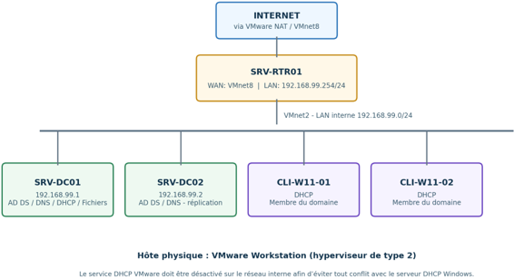
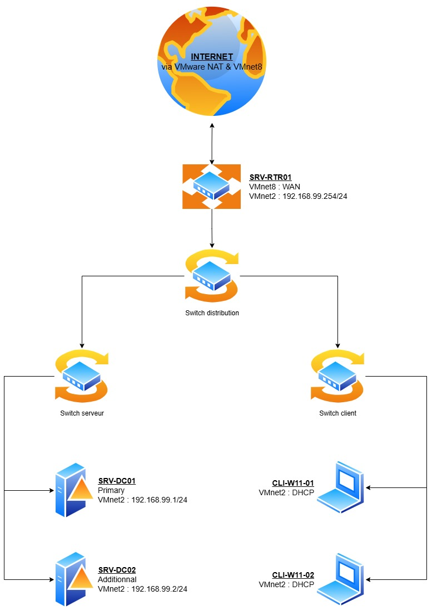

  

## `> tech_stack`

## `> overview`
Mise en œuvre d'une infrastructure Windows pour une PME : Active Directory, DHCP, DNS, GPO, Réplication, Partage NTFS, Routage, Script PowerShell.

Maquette réalisée sur **VMware Workstation Pro**. Les comptes rendus par domaine technique seront disponible dans `docs/`.

> Ce dépôt est référencé depuis [**SysNet Practice Labs**](https://github.com/SybillLabs/sysnet-practice-labs), le hub central de mes labs d'administration d'infrastructure sécurisée.

## `> initial_model`

## `> addressing_plan`

| Machine    | Adresse / Mode          | Rôle principal                       | Réseau VMware |
| ---------- | ----------------------- | ------------------------------------ | ------------- |
| SRV-RTR01  | LAN : 192.168.99.254/24 | Routeur                              | LAN : VMnet02 |
|            | WAN : DHCP / NAT VMware | NAT Windows                          | WAN : VMnet08 |
| SRV-DC01   | 192.168.99.1/24         | AD DS / DNS / DHCP / Fichiers / FSRM | LAN : VMnet02 |
| SRV-DC02   | 192.168.99.2/24         | AD DS / DNS / Réplication            | LAN : VMnet02 |
| CLI-W11-01 | DHCP                    | Poste client Windows 11              | LAN : VMnet02 |
| CLI-W11-02 | DHCP                    | Poste client Windows 11              | LAN : VMnet02 |

**Nom de domaine _Active Directory_ : `ais.test`.**

## `> documents`

1. [**Préparer la plateforme de virtualisation**](/docs/mission1.md)
2. [**Installer et préparer les systèmes Windows**](/docs/mission2.md)
3. [**Déployer le premier contrôleur de domaine**](/docs/mission3.md)
4. [**Mettre en place le DHCP et intégrer les clients**](/docs/mission4.md)
5. [**Structurer Active Directory**](/docs/mission5.md)
6. [**Ajouter SRV-DC02 et vérifier la réplication**](/docs/mission6.md)
7. [**Mettre en place les ressources de fichiers**](/docs/mission7.md)
8. [**Déployer les stratégies de groupe**](/docs/mission8.md)
9. [**Donner un accès Internet au LAN**](/docs/mission9.md)
10. [**Délégation et automatisation**](/docs/mission10.md)

## `> final_model`

---

    

