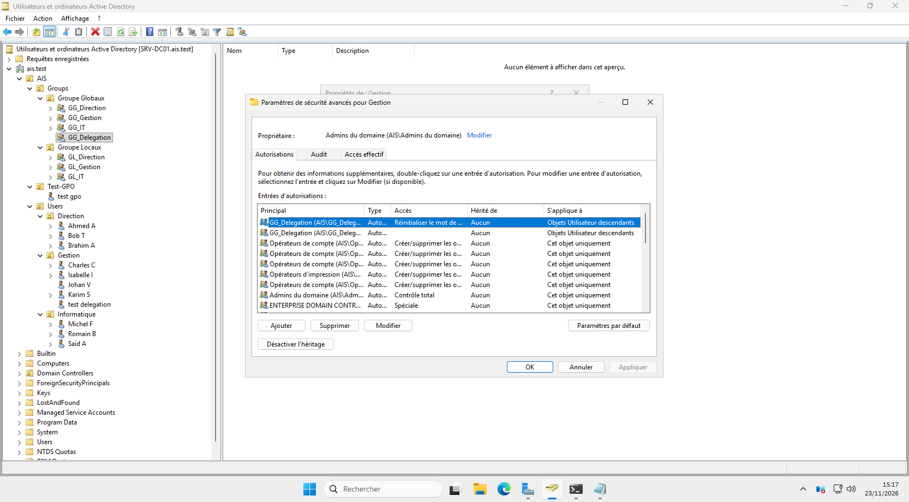
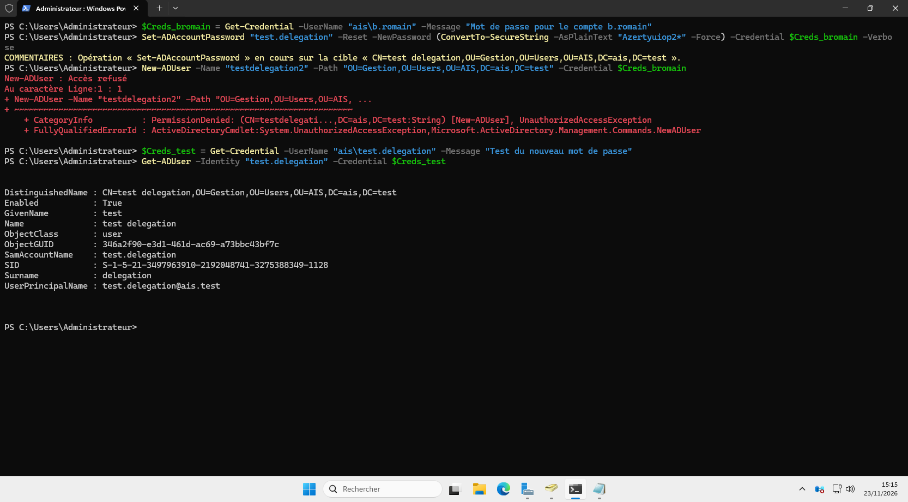
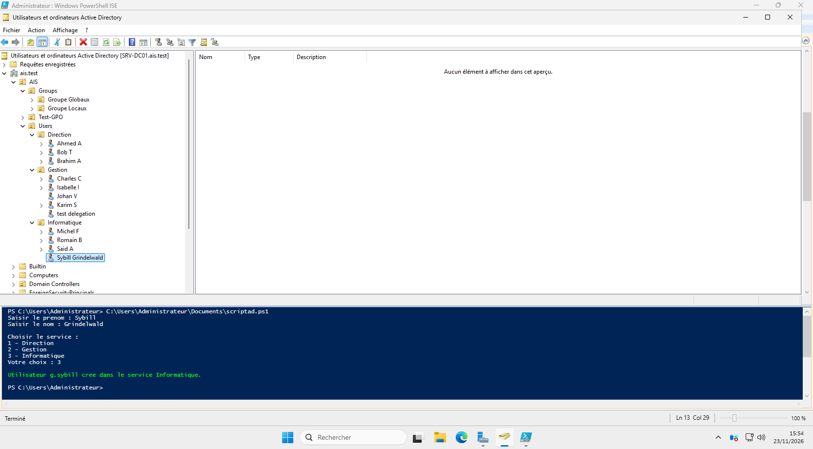

<h1 align="center">
    ⚙️ Délégation et automatisation
</h1>

## `> quickstart`
- Déléguer à l’utilisateur Romain B. le droit de réinitialiser les mots de passe des utilisateurs de l’OU Gestion, sans lui attribuer de privilèges Domain Admin.
- Tester la délégation avec un compte adapté.
- Créer ou adapter un script PowerShell permettant de créer un utilisateur Active Directory et de le placer directement dans l’OU correspondant à son service.
- Commenter les principales étapes du script afin d’expliquer son fonctionnement.

## `> control_point`
### 1. Délégation avec un compte adapté  
  


```powershell
# Variable pour contenir les identifiants de b.romain
$Creds_bromain = Get-Credential -UserName "ais\b.romain" -Message "Mot de passe pour le compte b.romain"

# Réinitialisation du mot de passe de test.delegation avec les identifications de b.romain
Set-ADAccountPassword "test.delegation" -Reset -NewPassword (ConvertTo-SecureString -AsPlainText "Azertyuiop2*" -Force) -Credential $Creds_bromain -Verbose

# Test de création d'un utilisateur dans Gestion avec les identifiants de b.romain alors qu'il a pas les droits.
New-ADUser -Name "testdelegation2" -Path "OU=Gestion,OU=Users,OU=AIS,DC=ais,DC=test" -Credential $Creds_bromain

# Variable pour contenir les identifiants de test.delegation avec le nouveau mot de passe
$Creds_test = Get-Credential -UserName "ais\test.delegation" -Message "Test du nouveau mot de passe"

# Afficher l'utilisateur test.delegation avec les derniers identifiants en date
Get-ADUser -Identity "test.delegation" -Credential $Creds_test
```

### 2. Script PowerShell  


```powershell

# ============================================
# SCRIPT : Creation utilisateur Active Directory
# Domaine : ais.test
# Ce script est utilisable une structure AD bien précise
# ============================================

# 1. Informations utilisateur

$Prenom = Read-Host "Saisir le prenom"
$Nom = Read-Host "Saisir le nom"
$Name = "$Prenom $Nom"

# 2. Creation de l'identifiant

#$Identifiant = ($Prenom.Substring(0,1) + "." + $Nom).ToLower()
# Substring() sert à extraire une portion de texte, dans mon cas la première lettre du prénom.
$Identifiant = ($Nom.Substring(0,1) + "." + $Prenom).ToLower()
# Substring() sert à extraire une portion de texte, dans mon cas la première lettre du nom.

# 3. Choix du service

Write-Host ""
Write-Host "Choisir le service :"
Write-Host "1 - Direction"
Write-Host "2 - Gestion"
Write-Host "3 - Informatique"

$Choix = Read-Host "Votre choix"

switch ($Choix) {
    "1" { $Service = "Direction" }
    "2" { $Service = "Gestion" }
    "3" { $Service = "Informatique" }
    default {
        Write-Host "Choix invalide. Arret du script." -ForegroundColor Red
        exit
    }
}

# 4. Definition de l'OU de destination

$OU = "OU=$Service,OU=Users,OU=AIS,DC=ais,DC=test"

# 5. Saisie du mot de passe

$MotDePasse = Read-Host "Saisir le mot de passe initial" -AsSecureString

# 6. Creation de l'utilisateur

New-ADUser `
    -Name "$Name" `
    -GivenName $Prenom `
    -Surname $Nom `
    -SamAccountName $Identifiant `
    -UserPrincipalName "$Identifiant@ais.test" `
    -Path $OU `
    -AccountPassword $MotDePasse `
    -Enabled $true `
    -ChangePasswordAtLogon $true

# 7. Confirmation

Write-Host ""
Write-Host "Utilisateur $Identifiant cree dans le service $Service." -ForegroundColor Green

```

## `> sources`
- [IT-Connect : La délégation de contrôle Active Directory](https://www.it-connect.fr/la-delegation-de-controle-active-directory/)


---

<p align="center">  
    <i>↪️ Back to<a href="https://github.com/SybillLabs/infra-windows-vmware.git"> Infrastructure Windows avec VMware</a></i>
</p>