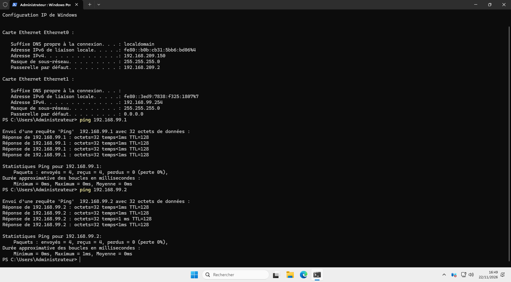
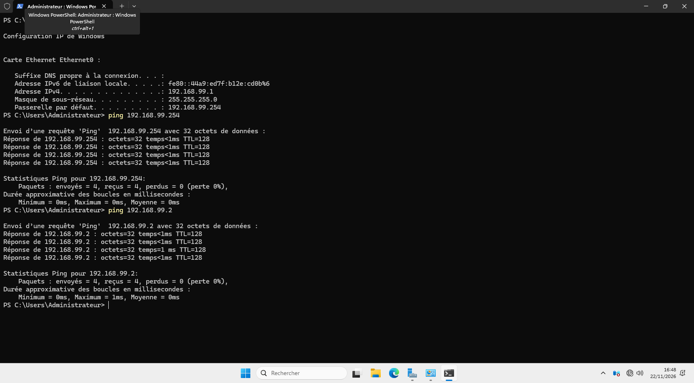
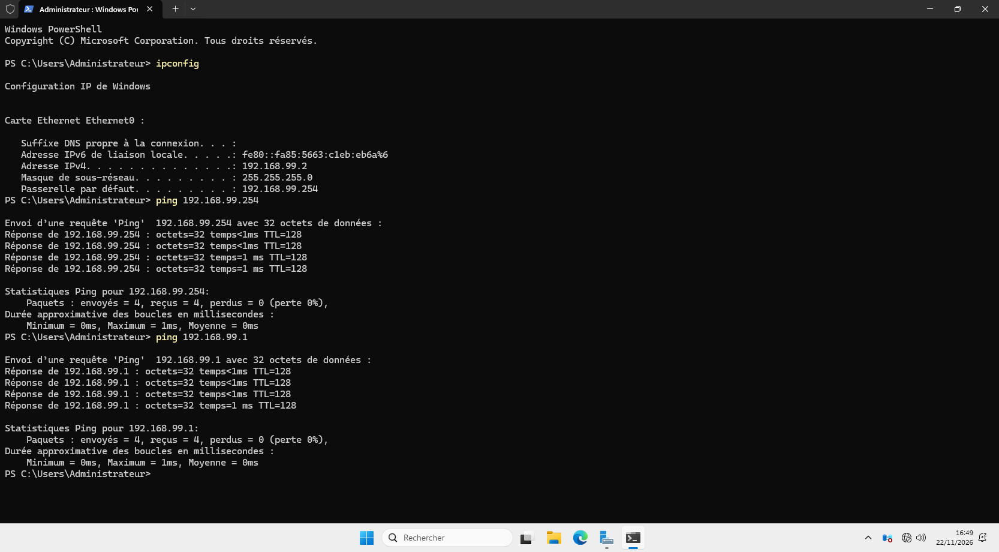

<h1 align="center">
    🪟 Installer et préparer les systèmes Windows
</h1>

## `> quickstart`
- Renommer les `HOSTNAME` des machines : **SRV-RTR01**, **SRV-DC01**, **SRV-DC02**, **CLI-W11-01**, **CLI-W11-02**
- Configurer les serveurs du LAN en ip statiques :
    - **SRV-RTR01** : 192.168.99.254/24
    - **SRV-DC01** : 192.168.99.1/24
    - **SRV-DC02** : 192.168.99.2/24
- Sur **SRV-DC01** , ajouter un second disque virtuel, l'initialiser, le formater en NTFS et lui attribuer la lettre `E:`.

## `> control_point`

### 1. Communication entre serveur LAN par adresse IP
- Ping depuis **SRV-RTR01**  

- Ping depuis **SRV-DC01**  

- Ping depuis **SRV-DC02**  

---

  
    <i>↪️ Back to<a href="https://github.com/SybillLabs/infra-windows-vmware"> Infrastructure Windows avec VMware</a></i>

