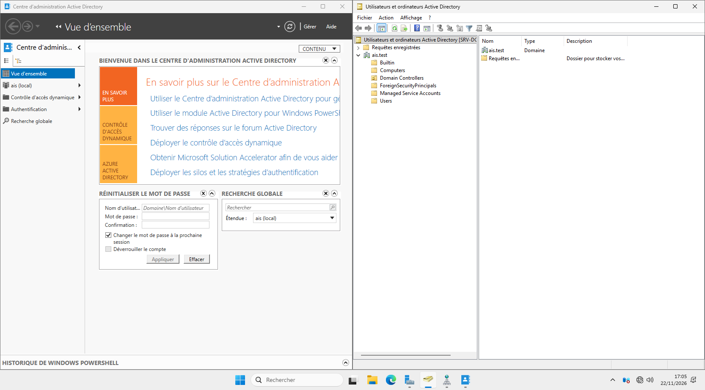
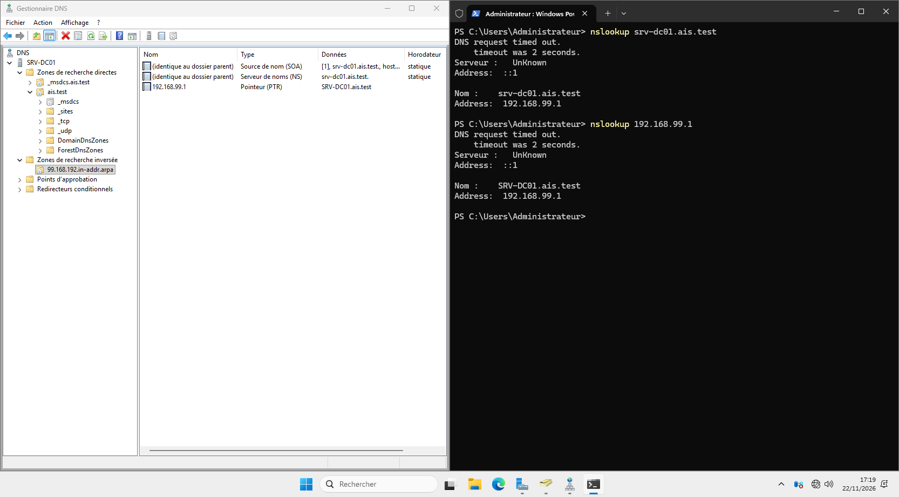
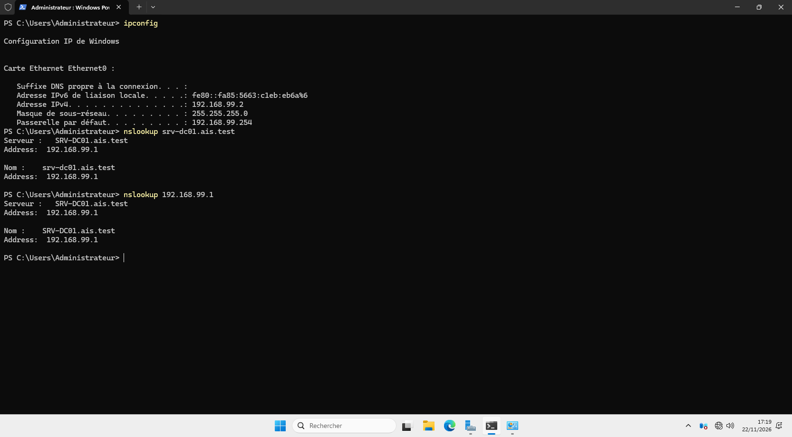
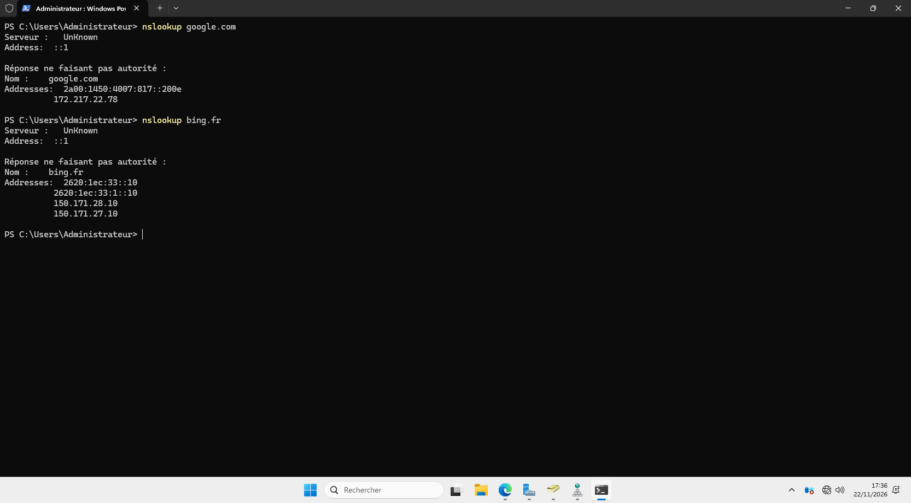

<h1 align="center">
    🚀 Déployer le premier contrôleur de domaine
</h1>

## `> quickstart`
- Installer et configurer `Active Directory Domain Services` sur **SRV-DC01**.
- Configurer le `DNS` sur **SRV-DC01**.
- Configurer le routage sur **SRV-RTR01**.

## `> control_point`
### 1. **SRV-DC01** en contrôleur de domaine  

### 2. **SRV-DC01** avec DNS opérationnel  

### 3. Test de résolution de nom depuis **SRV-DC02**  

### 4. Résolution DNS vers Internet depuis **SRV-DC01**

- Source : [IT-Connect : Comment configurer Windows Server 2025 comme routeur avec du NAT ?](https://www.it-connect.fr/comment-configurer-windows-server-2025-comme-routeur-avec-nat/)

---

  
    <i>↪️ Back to<a href="https://github.com/SybillLabs/infra-windows-vmware"> Infrastructure Windows avec VMware</a></i>

