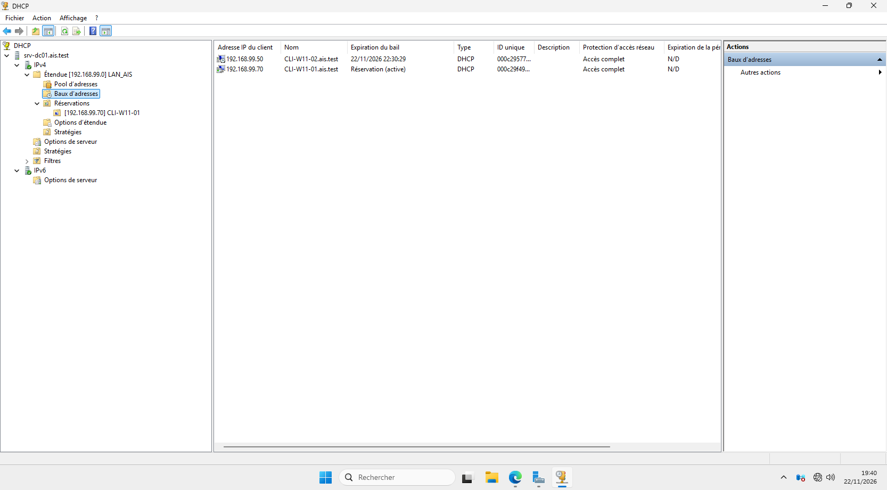
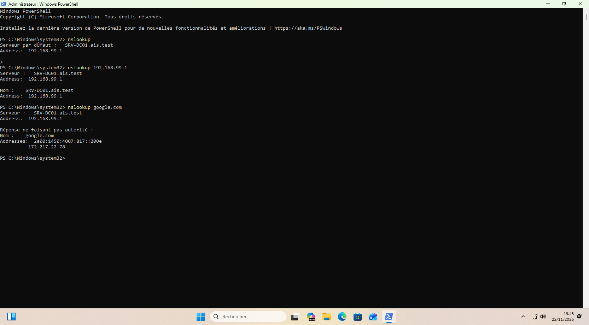

<h1 align="center">
    🌐 Mettre en place le DHCP et intégrer les clients
</h1>

## `> quickstart`
- Installer et configurer le rôle `DHCP` sur **SRV-DC01** (étendue, bail, passerelle, dns).
- Réserver l'adresse `192.168.99.70` pour **CLI-W11-01**.
- Joindre **CLI-W11-01** et **CLI-W11-02** au domaine `ais.test`.

## `> control_point`
### 1. Distribution et réservation des adresses par le DHCP sur **SRV-DC01**  

### 2. Résolution DNS du domaine depuis **CLI-W11-02**  

---

  
    <i>↪️ Back to<a href="https://github.com/SybillLabs/infra-windows-vmware"> Infrastructure Windows avec VMware</a></i>

