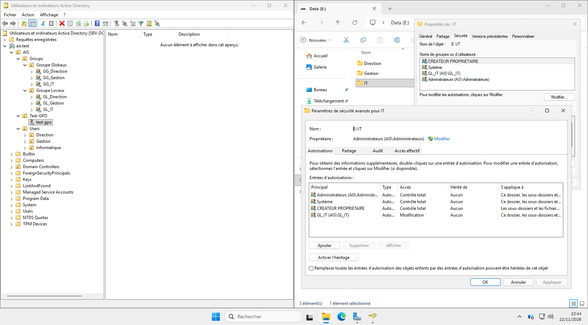
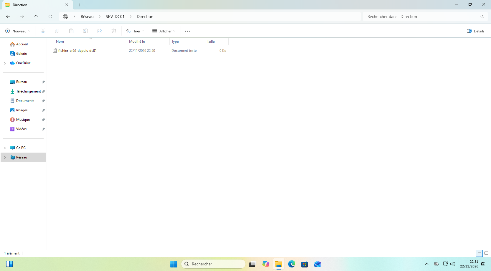
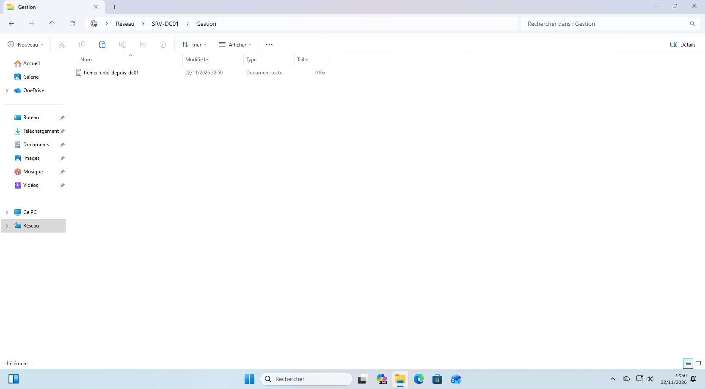

<h1 align="center">
    🗂️ Structurer Active Directory
</h1>

## `> quickstart`
- Structurer l'Active Directory avec les utilisateurs dans les OU correspondants et dans les Groupes correspondants.
- Appliquer un mot de passe temporaire, puis forcer le changement à la première ouverture de session.
- Mettre en œuvre la méthode AGDLP pour organiser l'attribution des droits d'accès aux ressources partagées.

## `> control_point`
### 1. Configuration AGDLP sur **SRV-DC01/GL_IT**  

### 2. Vérification AGDLP sur **CLI-W11-01/GL_Direction**

### 2. Vérification AGDLP sur **CLI-W11-02/GL_Gestion**

## `> F.A.Q`
- **_C'est quoi l'`AGDLP` ?_**

  C'est une méthode pour attribuer des droits sans jamais les donner directement aux personnes. Le sigle donne l'ordre : **A**ccount (compte) → **G**lobal (groupe global) → **D**omain **L**ocal (groupe local de domaine) → **P**ermission.
  - Les utilisateurs sont rangés dans un groupe global par service (`GG_Direction`).
  - Le groupe global est placé dans un groupe local de domaine, qui représente un droit sur une ressource (`GL_Direction`).
  - Seul le groupe local reçoit la permission sur le dossier.

  Exemple : `Ahmed A` → `GG_Direction` → `GL_Direction` → Modification sur `\\SRV-DC01\Direction`.
  Quand quelqu'un arrive ou part, on modifie un seul groupe, jamais les permissions du dossier.

- **_Pourquoi mettre `Utilisateurs authentifiés` à la place de `Tout le monde` ?_**

  `Tout le monde` s'applique à n'importe quel compte qui atteint le serveur, y compris un compte Invité s'il est activé. `Utilisateurs authentifiés` ne concerne que les comptes qui ont fourni des identifiants valides. C'est plus restrictif et conforme au principe du moindre privilège.
  Ici, le partage donne Contrôle total à `Utilisateurs authentifiés` et le vrai filtrage est fait par les permissions NTFS (le droit effectif est le plus restrictif des deux).

- **_Pourquoi désactiver l'héritage ?_**

  Par défaut, un dossier reprend les permissions de son parent (`C:\`), dont le groupe `Utilisateurs` qui a un accès en lecture. Tant que l'héritage est actif, ces lignes sont grisées et on ne peut pas les supprimer. Le désactiver permet de retirer les accès non voulus et de ne garder que les groupes `GL_` prévus. Sans cela, tous les utilisateurs du domaine pourraient lire le dossier.

- **_Pourquoi choisir `Convertir les autorisations héritées en autorisations explicites sur cet objet` plutôt que `supprimer toutes les autorisations héritées de cet objet` ?_**

  - **Convertir** copie les permissions héritées comme permissions propres au dossier. On garde `Administrateurs`, `Système` et `Créateur propriétaire`, et on supprime seulement `Utilisateurs`.
  - **Supprimer tout** laisse une liste vide : même l'administrateur est bloqué et il faut reprendre la propriété du dossier pour s'en sortir.

  Convertir est donc plus sûr : on part d'une base fonctionnelle et on la nettoie.

---

  
    <i>↪️ Back to<a href="https://github.com/SybillLabs/infra-windows-vmware"> Infrastructure Windows avec VMware</a></i>

