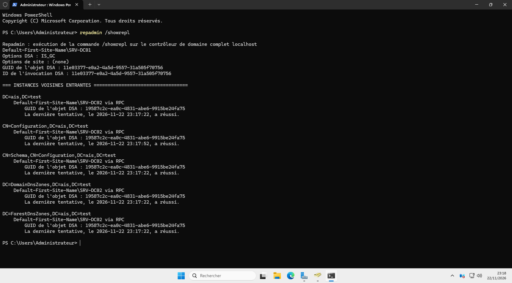
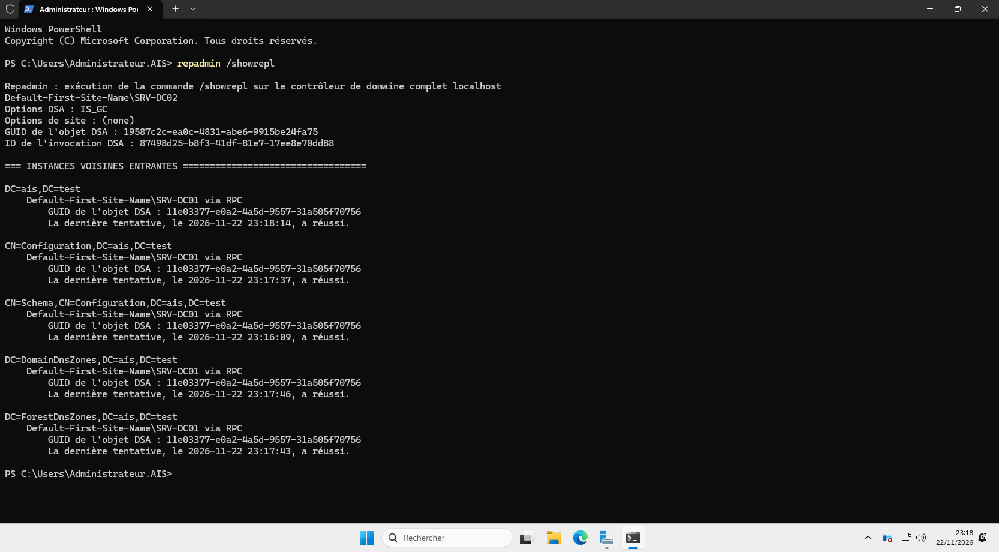
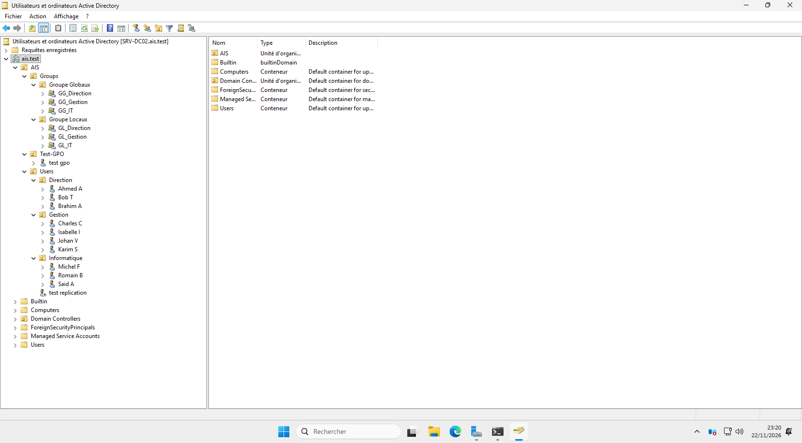
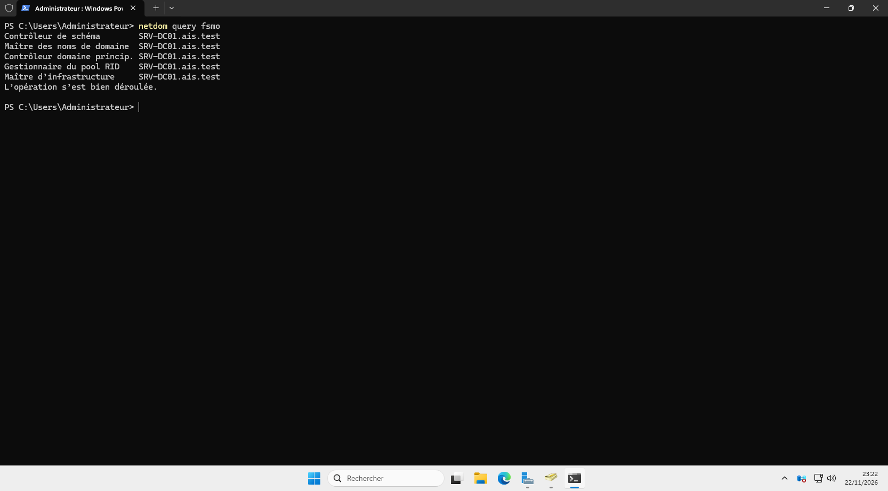

<h1 align="center">
    🔁 Ajouter SRV-DC02 et vérifier la réplication
</h1>

## `> quickstart`
- Joindre **SRV-DC02** au domaine `ais.test`.
- Installer les rôles `AD-DS` et `DNS` puis le promouvoir comme contrôleur de domaine supplémentaire.
- Vérifier la réplication avec les outils adaptés (*ADUC* ou *DNS Manager* ou *REPADMIN*)

## `> control_point`
### 1. Vue de la réplication de **SRV-DC01** vers **SRV-DC02** depuis **SRV-DC01** avec `repadmin`  

### 2. Vue de la réplication de **SRV-DC01** vers **SRV-DC02** depuis **SRV-DC02** avec `repadmin`  

### 3. Test de réplication en live avec l'`Active Directory Users and Computers`

### 4. Vérification d'aucune changement des rôles FSMO depuis **SRV-DC01**  

---

  
    <i>↪️ Back to<a href="https://github.com/SybillLabs/infra-windows-vmware.git"> Infrastructure Windows avec VMware</a></i>

