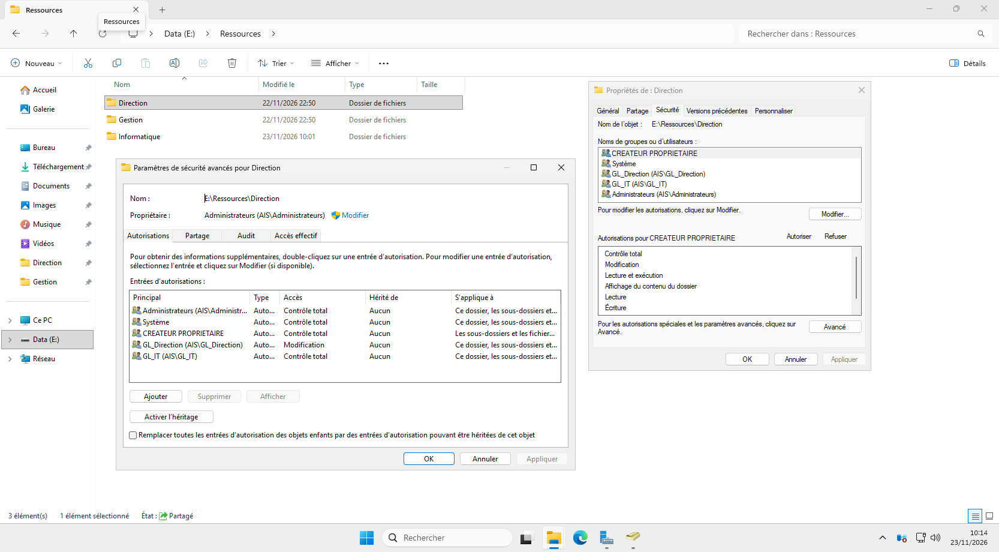
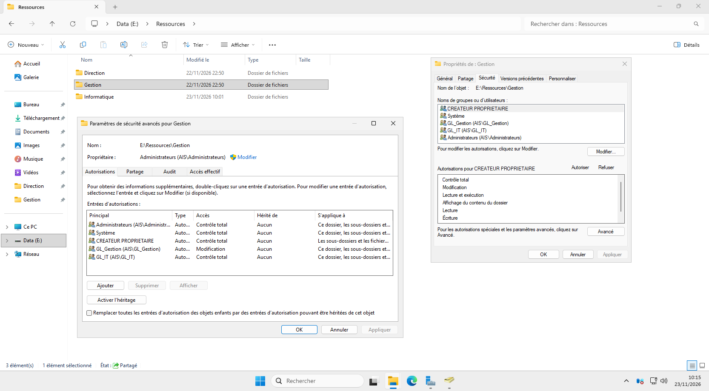
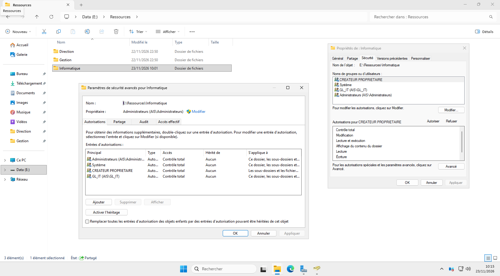
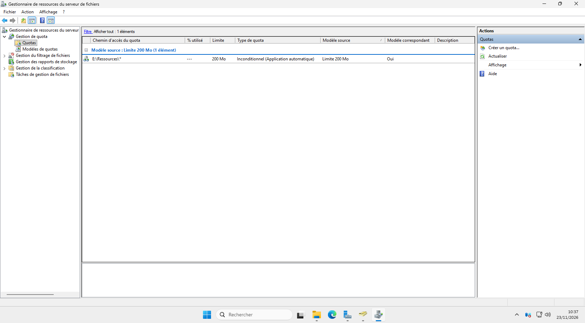

<h1 align="center">
    📁 Mettre en place les ressources de fichiers
</h1>

## `> quickstart`
- Définir les permissions de partage et NTFS cohérentes respectant l'**AGDLP**.
- Le groupe `GL_IT` doit disposer des droits nécessaires pour administrer les ressources de fichiers.
- Installation de FSRM et limitation de chaque répertoire à **200 Mo**.
- Générer un avertissement lorsque l'utilisation atteint **160 Mo**.

## `> control_point`
### 1. Permissions de partage et NTFS pour *Direction*  

### 2. Permissions de partage et NTFS pour *Gestion*  

### 3. Permissions de partage et NTFS pour *Informatique*  

### 4. Application du rôle FSRM avec limitation et avertissement sur chaque répertoire

---

  
    <i>↪️ Back to<a href="https://github.com/SybillLabs/infra-windows-vmware.git"> Infrastructure Windows avec VMware</a></i>

