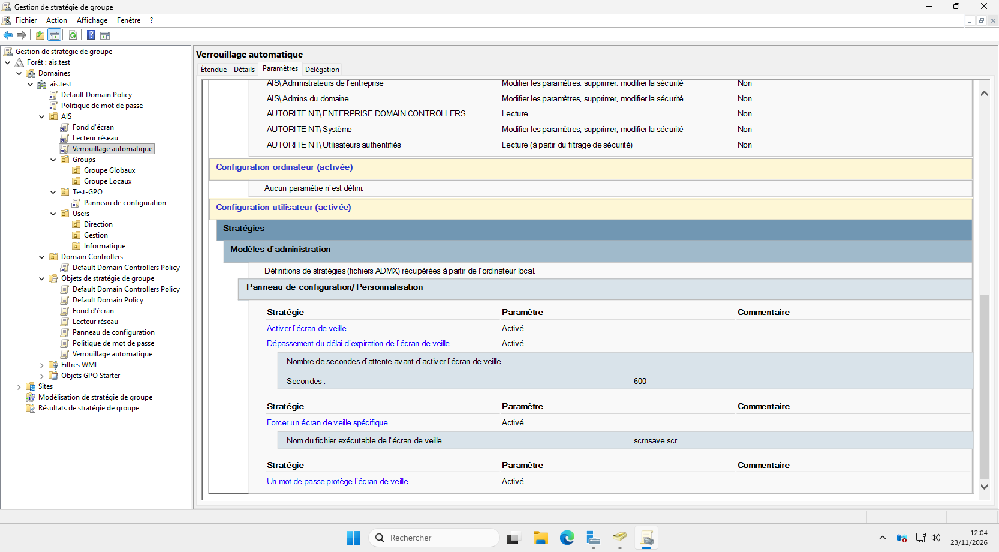
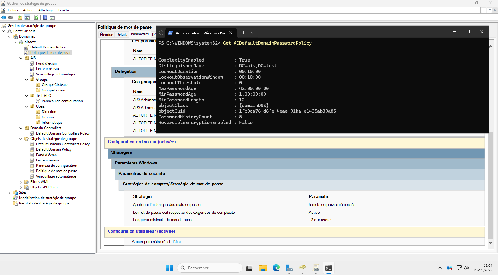
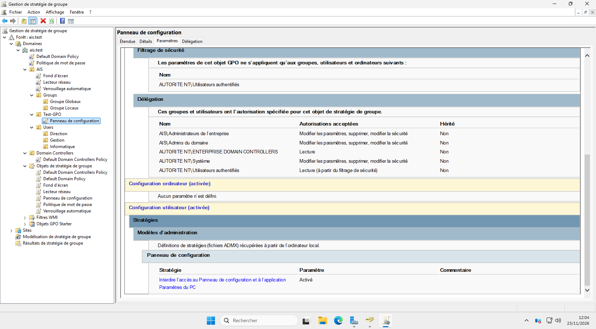
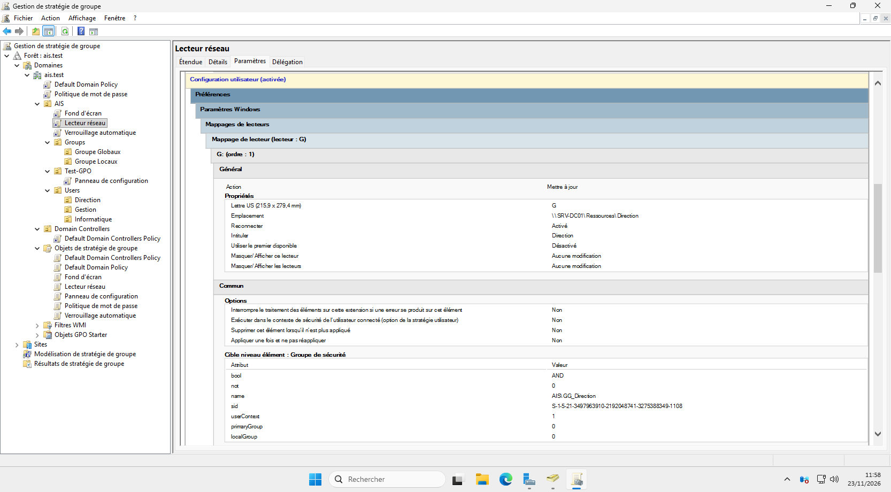
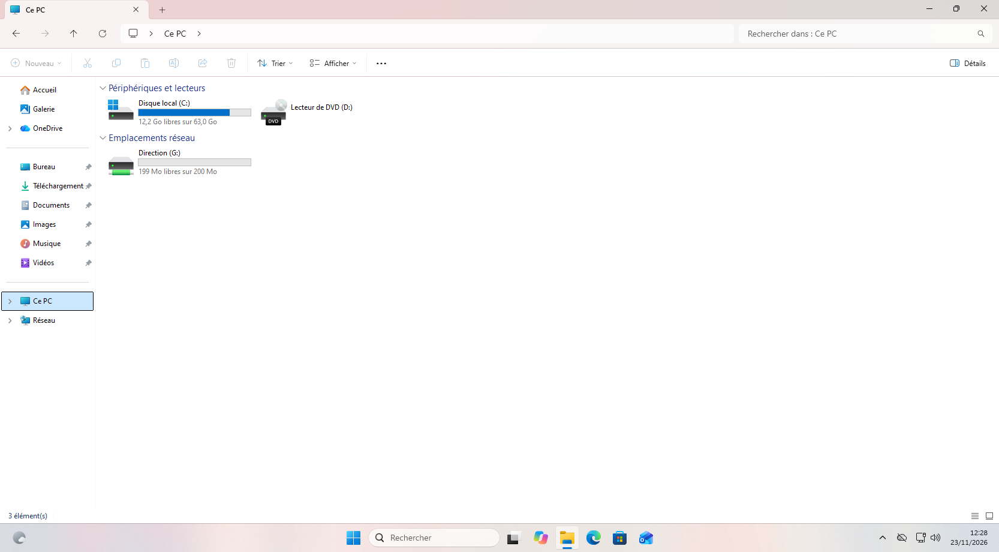
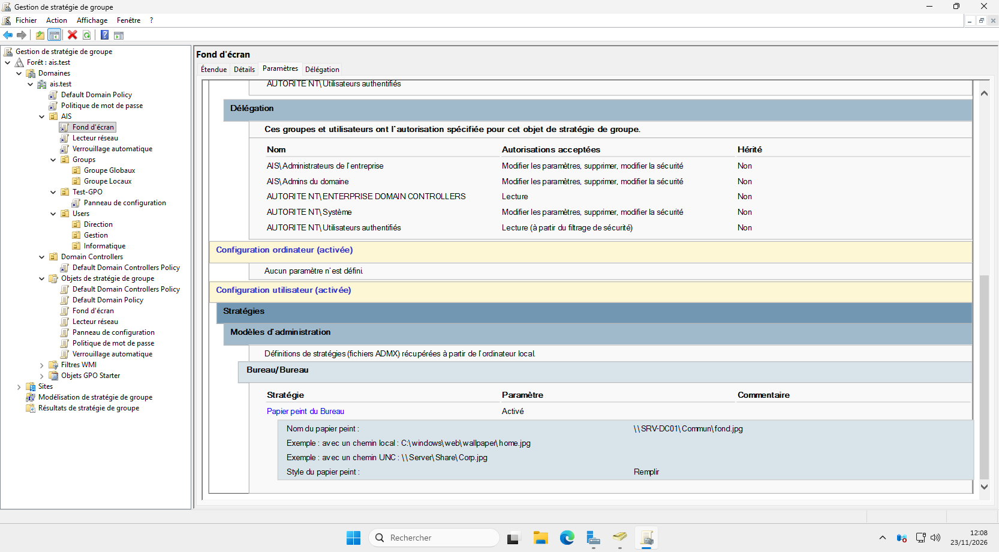
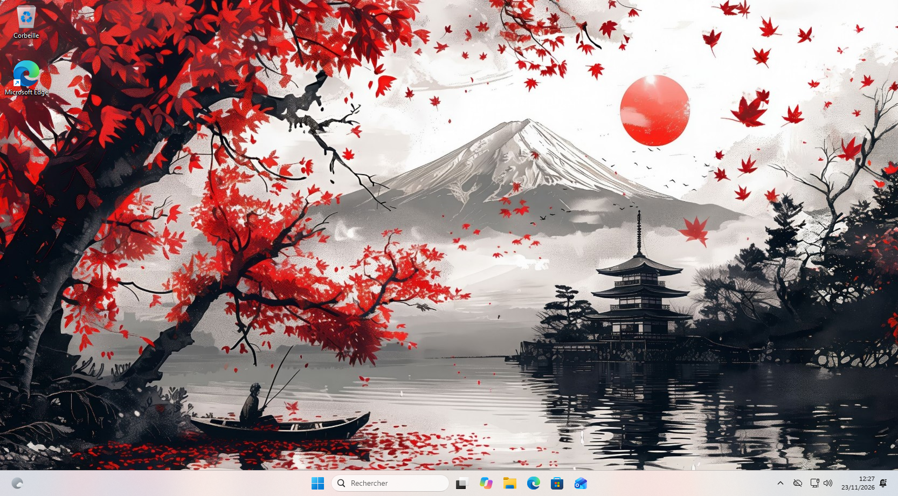
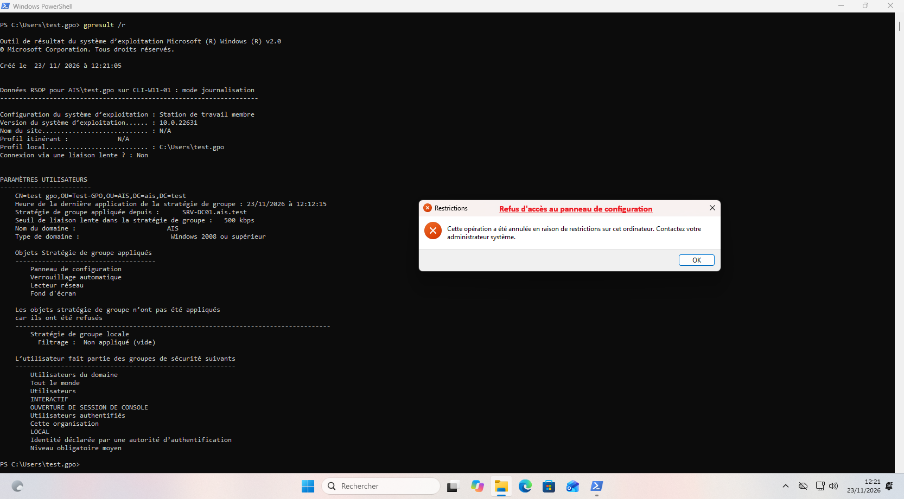

<h1 align="center">
    📑 Déployer les stratégies de groupe
</h1>

## `> quickstart`
- Mettre en œuvre ces cinq stratégies :

| GPO                       | Objectif                                                                              | Cible / Remarque                                                  |
| ------------------------- | ------------------------------------------------------------------------------------- | ----------------------------------------------------------------- |
| Verrouillage automatique  | Verrouiller la session après 10 minutes d'inactivité                                  | Utilisateurs du domaine                                           |
| Politique de mot de passe | Longueur minimale de 12 caractères, complexité activée, historique de 5 mots de passe | Politique appliquée au niveau du domaine                          |
| Panneau de configuration  | Interdire l'accès au Panneau de configuration et aux Paramètres Windows               | Uniquement l'OU Test-GPO                                          |
| Lecteurs réseau           | Mapper automatiquement les lecteurs correspondant au service de l'utilisateur         | Utiliser les groupes et/ou les préférences de stratégie de groupe |
| Fond d'écran entreprise   | Appliquer un fond d'écran commun depuis un emplacement réseau accessible en lecture   | Tester avec au moins un utilisateur du domaine                    |

## `> control_point`
### 1. Verrouillage automatique  

### 2. Politique de mot de passe

### 3. Panneau de configuration

### 4. Lecteurs réseau (*identique pour chaque dossier*)

### 5. Fond d'écran entreprise  

### 6. Test-GPO

---

  
    <i>↪️ Back to<a href="https://github.com/SybillLabs/infra-windows-vmware.git"> Infrastructure Windows avec VMware</a></i>

