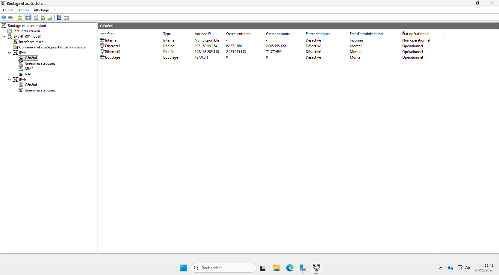
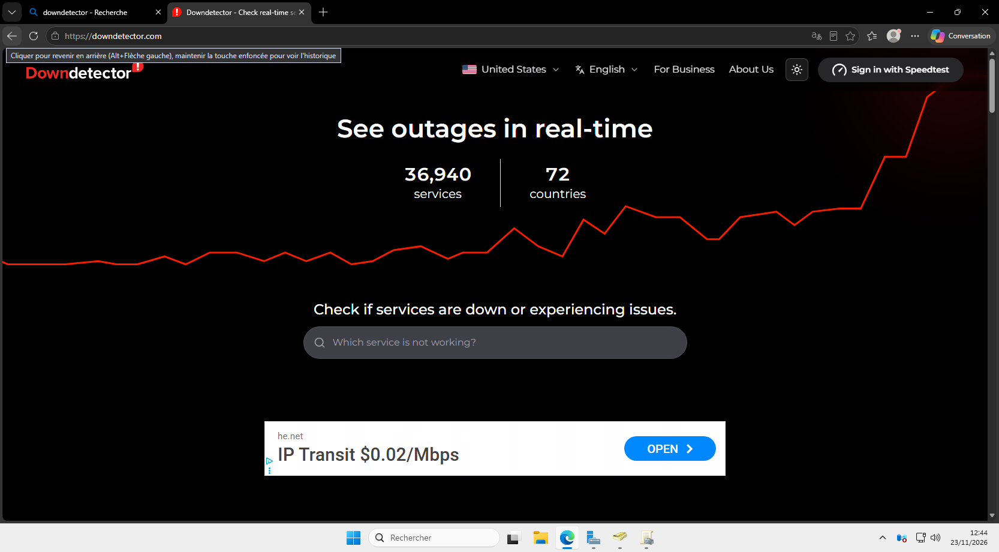
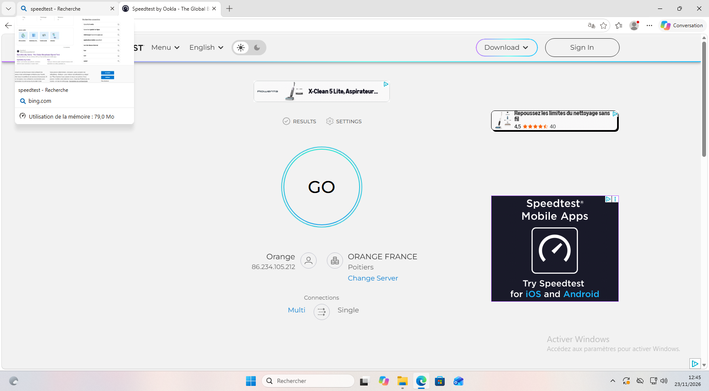
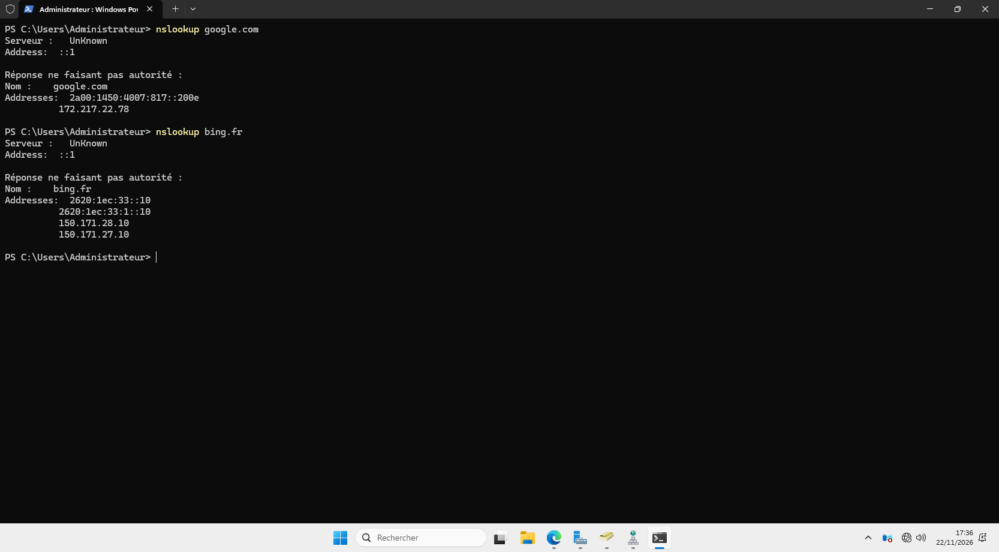

<h1 align="center">
    🖧 Donner un accès Internet au LAN
</h1>

## `> quickstart`
- Installer et configurer le service de routage/NAT Windows sur **SRV-RTR01**.
- Tester l'accès Internet depuis un serveur et un client.
- Tester la résolution DNS externe.

## `> control_point`
### 1. Service de routage/NAT Windows sur **SRV-RTR01**  

### 2. Accès internet depuis **SRV-DC01**  

### 3. Accès internet depuis **CLI-W11-01**  

### 4. Résolution DNS vers Internet depuis **SRV-DC01**

## `> sources`
- Source : [IT-Connect : Comment configurer Windows Server 2025 comme routeur avec du NAT ?](https://www.it-connect.fr/comment-configurer-windows-server-2025-comme-routeur-avec-nat/)

---

  
    <i>↪️ Back to<a href="https://github.com/SybillLabs/infra-windows-vmware.git"> Infrastructure Windows avec VMware</a></i>

